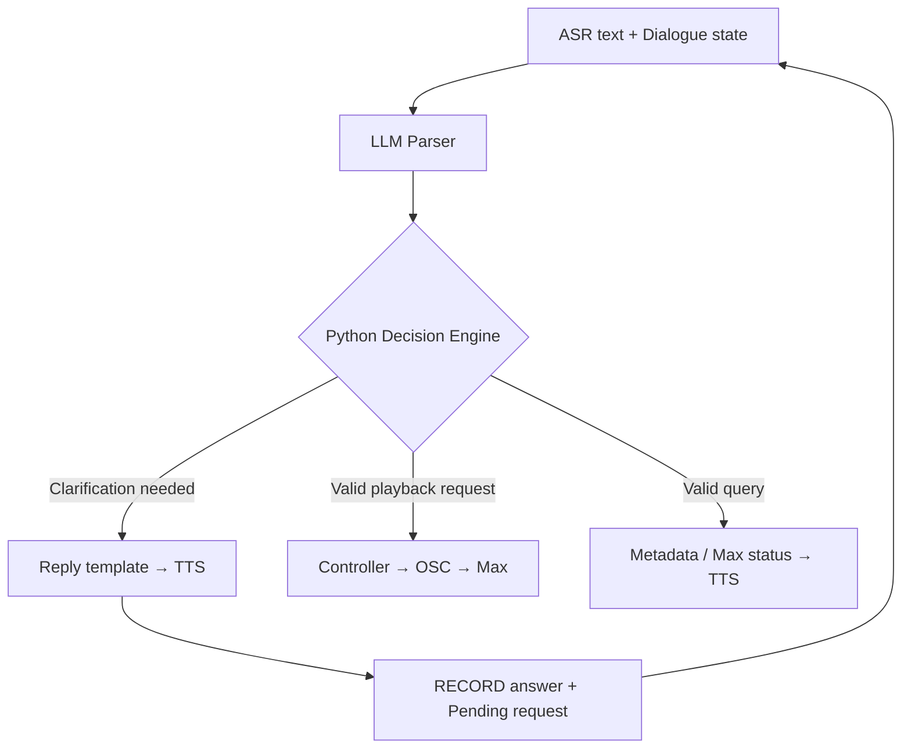

# Braille Score — Interaction Decisions and Voice Architecture

**Updated:** September 30, 2026 (America/New_York)  
**Basis:** The design discussion in this conversation, the existing Design Review, and the current playback/camera progress reports.  
**Status:** Specification for the next prototype. Design choices below are not evidence of completed implementation or measured performance.

## 1. Decision register

The following records the user's decisions and requirements from the discussion.

| ID | Decision / requirement |
|---|---|
| D01 | Test physical buttons already available at home as the next transport-control prototype. |
| D02 | Use separate PLAY, STOP, and RECORD functions. Keep MediaPipe finger tracking for measure selection. |
| D03 | Full mix playback is controlled by the PLAY button; ordinary Voice playback requests control Stems. |
| D04 | Playback type follows the user's choice. The system must not choose Full mix versus Stems on the user's behalf. |
| D05 | One Global STOP button controls both Full mix and Stem playback. |
| D06 | Reverb tails may decay naturally after stopping either playback type. Immediate complete silence is not the chosen stop behavior. |
| D07 | Use a RECORD button to define capture boundaries for the first prototype, allowing the user to pause, think, and revise while speaking. |
| D08 | Start recording with the first press; finish and submit with the second press, as the working three-button design. |
| D09 | Users normally pause music before speaking. If they have not done so, RECORD pauses it. |
| D10 | Answers to clarification questions also use RECORD. Automatic capture may be considered after the button-based workflow works. |
| D11 | After a query response, keep playback paused and wait for the user's next instruction. |
| D12 | Without an explicit length, playback runs from the resolved starting measure to the end of the piece. |
| D13 | Ordinary pre-playback speech announces Measure information only; a mandatory spoken Parts list is not required. |
| D14 | Support one or multiple requested Parts and explicit lengths such as “for four measures.” |
| D15 | Support natural variations such as “solo xxx track,” “only xxx instrument,” and “just play xxx and xxx,” including thinking pauses and self-corrections. |
| D16 | Use an LLM parser from the start of language-understanding development, rather than first building a comprehensive rule-based natural-language parser. |
| D17 | If an Instrument has multiple Parts and the user has not specified which, ask the user to choose. Do not automatically select all Parts. |
| D18 | Users may choose both/all relevant Parts explicitly, including replying “play both for me” to a clarification. |
| D19 | Support “play from last location” and “play the same selection.” |
| D20 | Last location means the previous successful playback's starting measure, not its stopped position. |
| D21 | Both Full mix and Stem playback update shared Playback history. |
| D22 | For Instrument activity feedback, examine the first two measures within the user's requested range. If the next measure contains music after a silent start, announce its entry measure. |
| D23 | If the checked activity window is silent, give a spoken notification, do not start playback, and wait for the next instruction. |
| D24 | Support measure awareness and Instrument/Part inventory information through Voice feedback: selected position, playback position, available Parts/counts, and activity at the selected location. |
| D25 | Latency means the waiting time after the user finishes the command until music is heard; the user's speaking/thinking duration is not the processing delay of interest. |
| D26 | The existing decisions are sufficient for the first prototype. Routine implementation details should use consistent defaults and testing rather than a long sequence of additional design questions. |

Architecture and implementation defaults are separated below from these interaction decisions. In particular, candidate models, exact response wording, and optional features have not become confirmed requirements simply because they were discussed.

## 2. Architecture and responsibilities

**Voice playback:** recording → ASR → LLM Parser → Python Decision Engine → Python Playback Controller → OSC → Max.

**Voice output:** Python response templates → TTS → spoken feedback.

**Direct transport:** button event → controller → Max, bypassing ASR and the LLM.



| Component | Responsibility |
|---|---|
| ASR — Automatic Speech Recognition | Convert recorded audio to text. |
| LLM Parser | Interpret natural phrasing, negation, self-correction, references such as “both,” and the supplied conversation context. Return a structured candidate request. |
| Python Decision Engine / Dialogue Manager | Check required information, score metadata, allowed operations, and current state; choose execution, clarification, or failure feedback. Maintain Pending requests. |
| Python Playback Controller | Resolve position/history, prepare transport and Part selection, issue OSC, manage cancellation, and record actual playback results. |
| Max | Execute Full mix or synchronized Stem playback and return playback status/position. |
| Response templates | Generate brief, predictable text from the selected feedback condition and real data. |
| TTS — Text-to-Speech | Read that text using a selected voice, rate, and volume. TTS does not decide what question to ask. |

Python also hosts recording and calls ASR/LLM/TTS. “Python Controller” names a responsibility within that application, not another model. The Decision Engine and Playback Controller can be ordinary modules in the same process. Separating modules does not imply additional serial model calls.

**First-prototype implementation direction:** one LLM parser plus a normal Python Decision Engine. No separate decision model, heavyweight dialogue framework, or custom NLU training pipeline is required initially. Jev was investigated as an optional decision-model candidate; it has not been adopted.

## 3. Physical control and recording behavior

| Control | Behavior |
|---|---|
| PLAY | Start Full mix from the valid selected location. |
| STOP | Stop Full mix and Stems, allowing tails; cancel unfinished commands and obsolete feedback. |
| RECORD, first press | Pause active music if needed and start recording a command or clarification answer. |
| RECORD, second press | End capture and submit the complete utterance for ASR and parsing. |

Working recording sequence:

1. Select the desired measure by touch/finger position.
2. Press RECORD. Pause music if it is still playing and capture the position anchor for a new request.
3. Speak, pause to think, and correct the wording as needed.
4. Press RECORD again. Process the complete request; do not execute an early fragment while capture is still open.
5. Clarify, answer a query, or announce the measure and execute a valid playback request.

A clarification answer uses the same RECORD workflow but preserves the original Pending request and position anchor.

Distinct short recording-start and submission cues were proposed. Exact sounds, tactile button shapes/placement, electronics, and wiring are implementation/testing work. Debounce and press/release handling should produce one event per press. A held button must not repeatedly trigger playback.

The purpose of RECORD is to reduce recording-boundary and premature-endpoint errors. It does not eliminate ASR transcription errors or LLM interpretation errors. Automatic VAD/Endpointing remains a possible later alternative, not a requirement for the first prototype.

Music pausing and leftover tails must be tested with the actual microphone/speaker setup. Pausing dry playback does not guarantee that every tail has already become inaudible. System TTS must not be captured and interpreted as a user command; recording and TTS scheduling need coordination.

## 4. Global STOP and explicit user control

Global STOP applies regardless of whether the current engine is Full mix or Stems, and regardless of camera registration/selection validity.

Planned controller behavior:

- Stop both playback engines, allowing the chosen tail behavior.
- Cancel a recording/Pending request and any unexecuted playback preparation.
- Interrupt obsolete TTS and clear its queued prompts.
- Invalidate outstanding request results so an ASR/LLM result arriving after STOP cannot restart music.
- Distinguish a user's STOP from an internal transport reset before a new play. An internal reset must not cancel its own request or produce a misleading “Stopped” announcement.

The existing Max stop destinations are `0` to Full mix `sfplay~` and `stop` to the Stem transport `line~`. These messages alone do not establish all required pause, cancellation, or tail behavior; the final patch/controller must be tested.

The Stem reverb is downstream of its dry playback gate and can decay after the dry signal ends. Full mix is an exported file played independently, so preserving its tail after an arbitrary stop needs verification rather than assuming the same behavior as the Stem reverb bus.

## 5. Voice command scope and semantics

| Request | Example | Required information |
|---|---|---|
| Play one Part | “Play flute one for four measures.” | Resolved Part, start position, length. |
| Play multiple Parts | “Just play flute one and cello.” | Resolved Parts, start position, length/default. |
| Select an Instrument with multiple Parts | “Solo the flute.” | Clarification when the Part selection is unresolved. |
| Reuse the previous starting location | “Play flute two from last location.” | Playback history plus Part selection and length/default. |
| Repeat a selection | “Play the same selection.” | Playback history; check compatibility with the user's chosen playback type/control path. |
| Query selected position | “Which measure am I pointing to?” | Valid selected measure. |
| Query playback position | “Which measure is playing?” | Actual Max position or saved pause position, appropriately described. |
| Query available Parts | “What instruments are available?” | Score inventory, Part names and counts. |
| Query local activity | “Which instruments play here?” | Activity metadata at the selected measure. |

Voice “Stop” was also proposed as a compatible optional command; the physical Global STOP is the confirmed transport control. Ordinary Voice requests to start Full mix were removed from the initial command scope because PLAY controls Full mix.

Do not confuse the Instruction vocabulary with exact required sentences. “Play,” “solo,” “only,” and “just play” can express the same Stem-selection operation. A fresh selection replaces the previously enabled Stem set instead of accumulating it.

The LLM must preserve meaningful negation/correction words. Do not blindly remove “no,” “not,” or “actually,” and do not simply collect every Instrument mentioned.

Example:

> “Um… play flute one… actually, flute two and cello… for four measures.”

Expected interpretation: Flute 2 + Cello, four measures, from the resolved anchor. Flute 1 is superseded by the correction.

Default length is **to the end**, not one measure. A supported replay of the same selection reuses the saved Parts and range rather than applying a fresh default length.

## 6. Part clarification and Dialogue state

Confirmed example:

> User: “Play flute.”  
> System: “Flute one, flute two, or both?”  
> User, using RECORD: “Play both for me.”

Python supplies the LLM with the new text, Pending request, previous question, available options, and relevant metadata. The reply “both” then refers to the two Flute Parts in that question. Explicit requests such as “both flutes” can resolve selection without another clarification.

The LLM should leave genuinely missing information unresolved rather than selecting Flute 1 arbitrarily. The Decision Engine checks the result against inventory and policy. Structured output constrains the format; it does not prove that the interpretation is correct.

**Illustrative candidate request, not a finalized API schema:**

```json
{
  "intent": "play_stems",
  "instrument": "flute",
  "part_selection": "unspecified",
  "position_reference": "current_selection",
  "requested_length": null
}
```

The Decision Engine applies the to-end default and asks about Part selection. It must not discard the anchor or already stated length while waiting for a reply.

Suggested structured fields include Intent, Instrument/Part selection, position reference, requested length, unresolved information, and clarification candidates. The controller—not the model—supplies real camera positions and verifies actual history.

Multiple selected Parts play simultaneously as the implementation starting default. Explicit sequential wording can be recognized, but sequential execution is a later feature and must not silently be treated as simultaneous if unsupported.

## 7. Position, pause state, and History

| State | Meaning |
|---|---|
| `selected_measure` | The current valid measure selected through finger tracking. |
| `command_anchor` | The frozen location for this request. RECORD-start snapshot is the implementation starting mechanism. |
| `playback_measure` | The measure reached by actual playback, obtained from Max. |
| `paused_position` | Actual transport position saved when recording pauses playback; may be inside a measure. |
| `last_playback` | Previous successful playback record: score identity, type, Parts if applicable, start, and range. |

These states may differ. A finger can point at measure 7 while music has reached measure 10. A clarification answer must preserve `command_anchor`; later finger movement must not change that request's start.

The latest camera report clears `last_pointed_measure` when no hand is detected. Button operation requires retaining a valid selection when a hand leaves to reach a button. Page changes, invalid registration, or a changed score require an explicit invalidation policy; retaining a selection is not permission to use stale geometry.

Confirmed History behavior:

- Full mix and Stem playback both update shared History.
- “Last location” uses the start measure of the previous successful playback. For playback starting at 7 and stopped at 10, Last location is still 7.
- “Same selection” requests a replay. For a Stem replay, retain the previous Parts, start, and range.
- Preserve the user's explicit Full mix/Stem choice. Shared History does not authorize the system to choose a playback type or silently convert a Full mix selection into a Stem selection.

Implementation defaults:

- Update successful History after Max acknowledges execution, not just because Python sent OSC.
- Failed, cancelled, unresolved, or silence-rejected requests do not overwrite it.
- If History is absent or incompatible with the requested path, give a focused clarification/feedback.
- After query feedback, remain paused and await instruction, as confirmed. Failed/cancelled requests also remain paused as a consistent implementation default.
- Explicit “Resume/Continue” from the exact pause position was discussed but was not confirmed as required. It is deferred rather than a blocker for the first prototype.

## 8. Instrument activity: two-measure feedback window

Evaluate the requested start measure and the following measure, staying inside the requested range and the end of the piece. This check covers at most two measures; default playback length still extends to the end.

For the initial multi-Part implementation, activity is checked collectively for the selected Parts: at least one selected Part with music counts as activity. Detailed reporting per Part can be refined later.

| Checked activity | Behavior | Proposed wording |
|---|---|---|
| Start measure has music | Normal measure announcement, then requested playback. | “Measure seven.” |
| Start measure is silent; the next requested measure has music | Announce the upcoming entry, then play from the requested start. | “Measure seven is silent. Sound starts in measure eight.” |
| Both checked measures are silent | Announce their silence, do not play, and await the next instruction. | “Measures seven and eight are silent.” |
| Only one measure is available in the request/piece | Check only that measure. If silent, notify and do not play. | “No instrument in this measure.” |
| Metadata is missing/uncertain | Report that activity cannot be determined; never assert silence from missing data. | “I can't determine the instrument activity here.” |

When the feedback window is silent, do not automatically resume paused music, search farther ahead, skip to a later entry, or update successful History. Music after that two-measure window does not override the user's no-playback rule.

The next-measure entry announcement preserves the requested start; it does not automatically skip the Rest. Wording must identify the checked measures instead of implying that the rest of the requested range is silent.

For “Which instruments play here?”, inspect the selected measure itself. This local query is distinct from the playback look-ahead check.

Proposed activity data: verified MusicXML/MIDI-derived note/rest activity, including tied/sustained notes. A Reverb tail alone should not count as a new instrumental entry. Exact data preparation and alignment with rendered Stems remain implementation work; the LLM should not invent activity.

## 9. Voice feedback and failure handling

Ordinary playback pre-announcements contain Measure information only. Clarifications and inventory replies may name Instruments and Parts because that information is necessary for the question/answer.

| Condition | Response behavior / example |
|---|---|
| Ambiguous Part | Ask the specific available choice: “Flute one, flute two, or both?” |
| No usable captured speech | Ask the user to try recording again. |
| Unrecognized request | Give one supported example rather than guessing an action. |
| Missing valid position | “Please select a measure first.” |
| Unavailable Instrument | Explain that the score has no such Part; do not select an alternative automatically. |
| Playback-position query | Use actual Max/pause state and describe it accurately. |
| Missing playback History | “There is no previous selection.” |
| Unsupported operation | Explain the supported scope briefly. |
| Confirmed silent window | Notify and wait; no playback. |

These phrases are draft templates, not fixed final wording. TTS is responsible only for reading the chosen text. An LLM need not generate a new response paragraph for every request.

An intelligible but incorrect ASR transcript can still produce a valid wrong selection. A measure-only pre-announcement does not verify the spoken Part selection. Test ASR/LLM accuracy on the actual vocabulary and allow correction/STOP; do not assume successful parsing proves correct recognition.

## 10. Model and runtime discussion

| Component | Candidate / discussion | Current status |
|---|---|---|
| ASR | Parakeet TDT 0.6B v3 through community `parakeet-mlx` for Apple Silicon. Its documented language set includes English, not Chinese. | Candidate; not installed/tested on the user's Mac in this conversation. Supported input language must match the chosen ASR. |
| ASR alternative | Whisper/`mlx-whisper`; multilingual Whisper can be considered if Chinese input is needed. | Discussed, not final selection. |
| LLM Parser | A local pretrained model such as Qwen through Ollama with Structured outputs, or a hosted LLM API. | Final model, size, and runtime not selected. Test natural commands before committing. |
| Dedicated NLU | Rasa DIET for Intent classification and Entity extraction, requiring domain examples/labels. | Discussed alternative; not the starting approach for free phrasing/self-correction. |
| Decision layer | Ordinary Python state/validation module. | Initial implementation direction. No extra model needed for metadata lookup, range checks, or cancellation. |
| Optional decision model | TypeSafe AI Jev, a System One model returning typed choices/probabilities. | Researched but not adopted; avoid an additional model/network call without a demonstrated need. |
| TTS | Built-in macOS speech synthesis; `say` was shown as a simple listening test. | Candidate for the prototype. Final voice/rate and application API remain implementation choices. |

The intended LLM parser uses a pretrained model for inference; custom training/fine-tuning was not required. Keep the model output short and structured. Validate it in Python before any playback action. A model-provided confidence value is not a correctness guarantee.

## 11. Latency definition and estimates

The user's primary metric is **end of spoken command → music heard**. Also log **RECORD submission → music output** to isolate application processing from any delay before the second button press. Do not add the utterance/thinking duration to the processing latency figure.

Include these intervals in the waiting time when applicable:

- Recording submission or automatic Endpointing wait.
- ASR processing/finalization.
- Complete LLM result, not merely its first output token.
- Python validation/controller and OSC/Max/audio-device startup.
- TTS startup and spoken pre-announcement duration if playback waits for it.

Earlier conversational planning estimates were about **1–4 seconds after submission without pre-announcement** and **3–8 seconds with a full pre-announcement**. These are not measurements. The subsequent measure-only decision shortens the proposed announcement; its actual duration and total latency still require testing.

An additional 1–2 seconds for automatic Endpointing was an illustrative configuration, not an adopted setting. RECORD avoids that automatic post-speech wait, though the user still controls when to submit. The earlier 50–200 ms button-to-audio figure was an engineering target, not verified performance.

Assumptions behind the rough estimates: short commands, local small-model inference, loaded/warmed models, short structured output, and no long generated Reasoning. Model size, prompt length, cold loading, concurrent camera processing, and audio configuration can change results.

Measure engine start and audible onset separately: a musical Rest at the requested position is content, not inference latency. Code modules themselves do not add another inference pass; an extra model/API call does. Jev's published speed is not a benchmark for this prototype or its entire pipeline.

## 12. Current Max/camera evidence and integration work

Progress-report facts:

- The current piece has 16 measures, 144 BPM, 4/4; fixed-tempo measure duration is approximately 1666.667 ms.
- Max has a synchronized 29-Stem engine, per-track gain selection, and a shared downstream reverb bus.
- Full mix uses an independent `sfplay~ 2` with `Mx_FullMix_L18_144bpm.wav`, including two bars of exported ending tail.
- The verified Python OSC path uses localhost port 7400 and `/bar N` / `/stop`. `/bar N` calculates `17 - N` measures to reach the end of measure 16.
- The gesture implementation sends an internal `/stop` before `/bar N` to retrigger playback at the updated position.
- The reported gestures are Closed_Fist for play and Open_Palm for stop. Gesture commands currently depend on LOCKED registration; the new Global STOP must remain usable independently.
- Full mix/bar-selection wiring changes were explained in this conversation but their running result was not verified here. Existing OSC reception in Max does not prove the full new voice interface exists.

Current Part IDs from the Phase 2 report:

```text
Woodwinds:  fl1 fl2 ob1 ob2 cl1 cl2 bsn1 bsn2
Brass:      fh1 fh2 fh3 fh4 tpt1 tpt2 tbn1 tbn2 tb
Percussion: glk bd sn
Strings:    vln1 vln2 vla vc cb
Others:     crash riser room stem
```

Inventory feedback must map IDs to spoken names and Part counts. The four “Others” entries should not automatically be presented as ordinary instrumental Parts without a deliberate inventory mapping.

Required integration work:

1. Carry a complete validated Stem selection and range into Max. Apply every parameter before triggering audio; do not start with stale gains or an earlier range.
2. Make Full mix and Stem transport mutually consistent so unintended concurrent playback does not occur.
3. Add Max → Python execution acknowledgements and playback/pause/stop/completion status, including actual position.
4. Implement real pause state for RECORD on both engines. Stopping `line~` alone is not proof of resumable transport.
5. Verify Global STOP, tails, and cancellation across both engines.
6. Retain/invalidate camera selections appropriately for button use.
7. Keep recording, ASR, LLM, and TTS work from blocking the camera loop; coordinate audio capture and speech output.

The request payload and new OSC addresses are implementation work. Illustrative JSON in this document does not define an already working Max protocol.

## 13. Implementation defaults and testing sequence

The following are engineering defaults rather than further questions blocking the prototype:

- Missing, ambiguous, or contradictory required information produces one focused clarification.
- A clearly new request replaces an older Pending request; a clarification reply preserves its original context and anchor.
- STOP cancels Pending work and invalidates late results.
- Invalid, cancelled, or failed requests leave music paused; valid explicit play instructions can start it.
- Validate score identity, Parts, positions, and ranges. Do not invent values or silently switch playback type.
- Exact prompt text, schemas, response phrasing, button cues, and expiry tuning can be refined during tests.

Development sequence:

1. Select a candidate LLM and test typed natural-language commands through Parser + Python Decision Engine.
2. Check aliases, fillers, negation, corrections, “both,” missing information, replay/History, invalid requests, and cancellation.
3. Connect validated actions and feedback to Max and TTS; verify acknowledgements and timing.
4. Add real recorded speech/ASR and the physical button interface.
5. Test complete tasks with the actual microphone, camera, score, and audio output; use blind-user feedback for usability rather than treating developer simulation as validation.

Explicit Resume/Continue, sequential playback, automatic recording/Endpointing, and detailed individual-Part activity reporting are later refinements. They are not prerequisites for the agreed core prototype.

## 14. Earlier design findings retained for continuity

These come from the Wizard of Oz demonstration and a conversation with one blind friend. They are observations/proposals, not results from a completed user study.

| Finding | Proposed response / current position |
|---|---|
| Repeated/unclear gesture activation | Test physical buttons; keep finger tracking. Gestures may remain available for comparison. Final controls should be assessed through use. |
| Users need measure awareness | Automatic pre-playback Measure announcement plus on-demand position queries; distinguish selection from actual playback. |
| Users need to know whether Instruments are active | The two-measure feedback/no-playback rule in Section 8 is the updated decision. |
| Instrument names and Part counts are unclear | Voice inventory information and Part clarification. |
| Paper may move outside the registration frame | Proposed larger frame, tactile tape on all four edges, and a warning beep. Paper-displacement detection and independent recovery still need validation. |
| Final application interface/OS | Still undecided: the Mac prototype does not settle a final Mac, Windows, or iPhone product. |

Replacing gestures removes the gesture-command layer, not MediaPipe finger tracking. HandLandmarker is a possible finger-only implementation alternative to the existing GestureRecognizer; switching back has not been verified here.

Earlier project decisions also rejected the active IR finger marker and a personalized ML model. Those outdated elements in the older README should not be treated as the current implementation. A separate command-hand zone was a feedback question, not a confirmed built feature.

## 15. Sources and review scope

- The user/assistant discussion in this conversation, especially the explicit choices recorded in Section 1.
- `Braille-Score-Design-Review.md` for the earlier Wizard of Oz findings and physical-button proposal.
- `Max-Playback-Report-phase1.md`, `Max-Playback-Report-phase2(1).md`, and `Gesture-OSC-Integration-Report.md` for existing playback and OSC/camera behavior.
- The older `README.md` is a proposal source; where it conflicts with later reports or explicit user decisions, the later material governs this specification.

Primary documentation consulted during the discussion:

- [Parakeet model card](https://huggingface.co/nvidia/parakeet-tdt-0.6b-v3)
- [parakeet-mlx](https://github.com/senstella/parakeet-mlx)
- [Ollama Structured outputs](https://docs.ollama.com/capabilities/structured-outputs)
- [Ollama performance metrics](https://docs.ollama.com/api/usage)
- [Apple Speech synthesis](https://developer.apple.com/documentation/avfaudio/speech-synthesis)
- [TypeSafe/Jev introduction](https://docs.typesafe.ai/introduction)
- [TypeSafe/Jev Quick start](https://docs.typesafe.ai/introduction/quickstart)
- [TypeSafe/Jev limitations](https://docs.typesafe.ai/model-jaggedness/jev-1.13)
- [Cycling '74 sfplay~ reference](https://docs.cycling74.com/reference/sfplay~/)

No ASR, LLM, TTS, button latency, or complete voice-to-Max execution was benchmarked on the user's Mac in this conversation. This document records what was decided, what is an implementation default, and what still needs to be built/tested.
