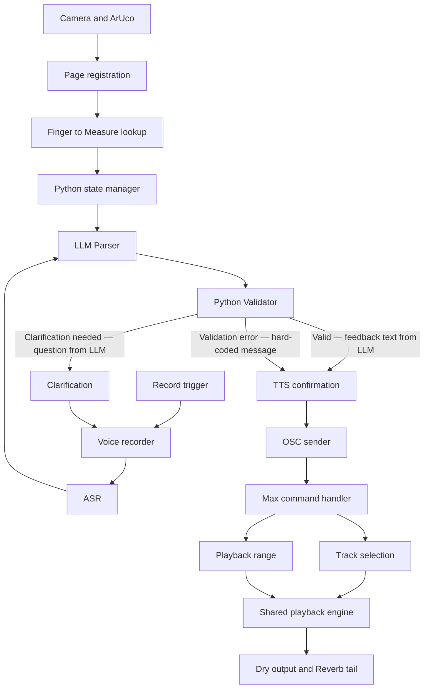

# Voice-Controlled Multistem Playback System

## 1. Purpose and Current Scope

This document defines the system architecture for connecting physical Braille-score position tracking, voice commands, and synchronized multistem playback in Max/MSP.

The current engineering priorities are:

1. Make Max/MSP accept and correctly execute arbitrary single-stem and multistem commands.
2. Add voice recording, ASR, deterministic command parsing, validation, clarification, TTS feedback, and OSC output.

Physical Play/Stop/Record buttons will be added after the command and voice pipelines are stable. During development, recording may be triggered by a keyboard key or a temporary on-screen control. Replacing that trigger with a physical button must not change the downstream voice or playback architecture.

Machine-learning inference about reading behavior is outside the scope of this implementation stage.

## 2. Current Implementation Baseline

The following components are already implemented and tested:

- ArUco page identification and locked homography;
- MediaPipe index-fingertip tracking;
- conversion from camera coordinates to canonical page coordinates;
- `page_map.json` lookup from fingertip position to Measure number;
- OSC communication from Python to Max on UDP port `7400`;
- `/stop` and `/bar N` control for playing all stems from a detected Measure;
- synchronized playback of 29 stereo stems using one shared signal-rate playhead;
- per-stem Track IDs and shared mute/unmute routing;
- local Dry playback with a shared Reverb return whose tail can continue after the Dry range stops;
- a working `vln1` Solo + Play prototype.

The following components are not yet confirmed as complete:

- dynamic selection of any arbitrary list of Stems from one OSC command;
- typed-command control of single and multiple Stems;
- voice recording and Voice Activity Detection;
- ASR;
- deterministic command parsing;
- command validation and clarification;
- TTS confirmation;
- complete voice-to-Max integration.

## 3. System Architecture



The architecture has one main division of responsibility:

- **Python** determines what the user requested, resolves all required parameters, validates the command, manages interaction state, and sends a complete command.
- **Max/MSP** executes the received command, selects the requested Stems, calculates the playback range, and produces synchronized audio.

Max must never interpret natural language. Python must never attempt to play or synchronize the audio Stems itself.

## 4. Runtime Data Flow

### 4.1 Position tracking

The camera pipeline outputs the Measure currently touched by the reading finger:

```text
Camera frame
→ ArUco page identification
→ locked homography
→ MediaPipe fingertip position
→ canonical page coordinate
→ page_map.json lookup
→ current_measure
```

Example:

```python
current_measure = 5
```

`current_measure` updates as the finger moves. Position tracking does not start playback by itself.

### 4.2 Voice anchoring

At the moment recording begins, Python freezes the current stable position:

```python
anchor_measure = current_measure
```

Movement during or after the spoken request must not change `anchor_measure` for that request.

During development, a keyboard key may create the Record event. The final physical Record button will create the same event.

### 4.3 Speech recognition

The Voice Recorder sends captured audio to the ASR module:

```text
Speech audio → ASR → transcript
```

Example:

```text
Spoken input: Play flute one and violin one.
Transcript:   play flute one and violin one
```

The ASR module only produces text. It does not select Track IDs or send commands to Max.

### 4.4 Command parsing

The LLM Parser converts the transcript and current system state into a structured command **and** a feedback text string in a single inference call. No separate response-generation model is needed.

Example output:

```json
{
  "status": "execute",
  "cmd": "play_stems",
  "tracks": ["fl1", "vln1"],
  "start": 5,
  "end": 16,
  "feedback_text": "Playing flute one and violin one from measure five.",
  "clarification_question": null
}
```

Clarification output:

```json
{
  "status": "clarify",
  "cmd": null,
  "tracks": [],
  "start": null,
  "end": null,
  "feedback_text": null,
  "clarification_question": "Flute one, flute two, or both?"
}
```

The LLM parser is responsible for:

- identifying the requested action;
- resolving spoken instrument names to Track IDs;
- detecting explicit Measure numbers and ranges;
- applying the default start and end rules;
- resolving commands such as `same selection` and `same selection again`;
- marking missing or ambiguous information as `clarify` instead of guessing;
- generating the feedback text that matches the resolved command.

The LLM receives the known track list and valid measure range in the system prompt and is expected to self-validate before producing output. A Python Validator checks the output as a safety net; validation failures use hard-coded error messages rather than a second LLM call.

**Model selection (see D29):** GPT-4o-mini (OpenAI API) during development for guaranteed JSON Schema compliance. Qwen2.5:7b via local Ollama for deployment.

### 4.5 Validation and clarification

Before any OSC message is sent, the Command Validator checks:

- `action` is supported;
- every Track ID exists;
- at least one Track is selected for `play_stems`;
- `start_measure` and `end_measure` are integers from 1 through 16;
- `end_measure >= start_measure`;
- the requested instruments have playable material in the requested range, when availability metadata is enabled.

A valid command proceeds to confirmation and execution. An invalid or ambiguous command produces a short clarification prompt and does not reach Max.

Examples:

```text
Which instrument would you like to hear?
Did you mean Flute 1 or Flute 2?
This excerpt contains Measures 1 through 16.
There is no Flute 1 material in this range.
```

### 4.6 TTS confirmation

After validation, TTS announces the interpreted request:

```text
Playing Flute 1 and Violin 1 from Measure 5 to the end.
```

For a bounded range:

```text
Playing Flute 1 and Flute 2 from Measure 5 through Measure 8.
```

The OSC playback command is sent after the confirmation finishes so that speech and music do not overlap.

### 4.7 OSC transmission

Python converts the validated command into one of the OSC messages defined in Section 7 and sends it to Max/MSP at:

```text
Host: 127.0.0.1
Port: 7400
```

### 4.8 Max execution

For a `play_stems` request, Max executes this order:

```text
STOP current playback
→ mute all Stems
→ enable every requested Stem
→ calculate the requested playback range
→ start the shared playhead
```

Example:

```text
/play_stems 5 8 fl1 fl2 vln1

Max execution:
stop
all 0.
fl1 1.
fl2 1.
vln1 1.
play Measures 5–8
```

All requested Stems use the existing shared signal-rate playhead and therefore remain sample-synchronized.

## 5. Module Responsibilities

| Module | Inputs | Outputs | Responsibility |
|---|---|---|---|
| Camera Capture | Live camera frames | Image frames | Supplies the physical interaction view |
| ArUco Registration | Image frames | Page ID and locked homography | Identifies the Braille page and maintains a stable coordinate transform |
| Finger Tracking | Registered frames | Fingertip camera coordinate | Locates the reading finger with MediaPipe |
| Measure Lookup | Page ID, homography, fingertip coordinate, `page_map.json` | `current_measure` | Converts physical position into a score Measure |
| State Manager | Measure updates, Record events, successful commands | Anchors and prior-command state | Maintains current position, frozen request position, previous selection, and previous range |
| Record Controller | Keyboard, UI, or future Button event | Audio recording session | Starts and stops capture; freezes `anchor_measure` at recording start |
| ASR | Recorded audio | Transcript | Converts speech into text |
| LLM Parser | Transcript, system state, and dialogue context | Structured command candidate + feedback text string (single LLM call) | Resolves actions, instruments, Measures, ranges, and repeat commands; generates confirmation or clarification text; marks unresolved information instead of guessing |
| Command Validator | Structured command candidate and score metadata | Validated command or clarification need | Prevents incomplete, unsupported, or out-of-range commands from reaching Max |
| Clarification Manager | Validation error | Spoken follow-up prompt | Requests only the missing or ambiguous information |
| TTS | Confirmation or clarification text | Spoken feedback | Provides nonvisual confirmation and error recovery |
| OSC Sender | Validated command | OSC packet | Serializes and sends the command to Max |
| Max Command Handler | OSC packet | Ordered internal Max messages | Routes commands and guarantees execution order |
| Track Selector | Track list | Per-stem gain states | Mutes all Stems, then enables the requested combination |
| Range Calculator | Start and end Measures | Start time and duration | Converts the inclusive Measure range into playback timing |
| Shared Playback Engine | Timing and Track states | Synchronized multistem audio | Drives all `play~` objects from one signal-rate playhead |
| Reverb Return | Summed local Stem audio | Wet tail | Continues the Reverb tail after bounded Dry playback ends |

## 6. System State

Python must store separate variables for separate meanings:

```python
current_measure = 7
anchor_measure = 5
last_playback_start_measure = 5
last_selection = ["fl1", "vln1"]
last_range = [5, 8]
```

| Variable | Meaning | Update rule |
|---|---|---|
| `current_measure` | Measure currently touched | Updates from the camera pipeline when a valid Measure is detected |
| `anchor_measure` | Frozen start candidate for the current voice request | Captured once when recording begins |
| `last_playback_start_measure` | Start Measure of the last successfully executed command | Updates only after successful validation and execution |
| `last_selection` | Track IDs used by the last successful Stem request | Updates only after successful validation and execution |
| `last_range` | Inclusive start and end Measures of the last successful request | Updates only after successful validation and execution |

These values must not be collapsed into one `last_measure` variable because the finger may move after a voice request has started.

## 7. OSC Command Contract

### 7.1 Play selected Stems

```text
/play_stems <start_measure> <end_measure> <track_1> [track_2 ...]
```

Example:

```text
/play_stems 5 8 fl1 fl2 vln1
```

Meaning:

- play Measures 5, 6, 7, and 8;
- enable only `fl1`, `fl2`, and `vln1`;
- stop the Dry audio at the beginning of Measure 9;
- allow the existing Reverb tail to continue.

### 7.2 Play all Stems

```text
/play_all <start_measure> <end_measure>
```

Example:

```text
/play_all 5 16
```

Max must send `all 1.` before starting playback so that a previous Solo or selected-Stem state cannot carry into `play_all`.

### 7.3 Stop

```text
/stop
```

This stops the shared Dry playback. The Reverb return remains free to decay naturally.

### 7.4 Development compatibility

The existing command may remain temporarily available while the new interface is being tested:

```text
/bar <start_measure>
```

It represents all-Stem playback from the specified Measure to Measure 16. New voice-control code should use `/play_all` or `/play_stems`.

## 8. Track IDs

The existing Max Track IDs are:

```text
Woodwinds:  fl1 fl2 ob1 ob2 cl1 cl2 bsn1 bsn2
Brass:      fh1 fh2 fh3 fh4 tpt1 tpt2 tbn1 tbn2 tb
Percussion: glk bd sn
Strings:    vln1 vln2 vla vc cb
Others:     crash riser room stem
```

The parser will maintain spoken aliases separately from these canonical IDs. Examples:

| Spoken name | Canonical Track ID or IDs |
|---|---|
| Flute 1 / First Flute | `fl1` |
| Flute 2 / Second Flute | `fl2` |
| Both Flutes / All Flutes | `fl1`, `fl2` |
| Violin 1 / First Violin | `vln1` |
| Violin 2 / Second Violin | `vln2` |
| Both Violins / All Violins | `vln1`, `vln2` |
| Viola | `vla` |
| Cello / Violoncello | `vc` |
| Double Bass / Contrabass | `cb` |

`tracks.json` should become the authoritative source for canonical IDs, user-facing names, spoken aliases, and optional Measure-level availability.

## 9. Measure Range Semantics

The range is inclusive:

```text
start_measure = 5
end_measure = 8
```

means Measures 5, 6, 7, and 8 are played, and Dry audio stops at the beginning of Measure 9.

For the current fixed-tempo excerpt:

```text
Tempo:          144 BPM
Meter:          4/4
Measure length: 1666.667 ms
```

Max calculates:

```text
start_time_ms = (start_measure - 1) × 1666.667
duration_ms   = (end_measure - start_measure + 1) × 1666.667
```

Example for Measures 5–8:

```text
start_time_ms = 6666.668 ms
duration_ms   = 6666.668 ms
```

This fixed calculation is valid for the current constant-tempo excerpt. A later variable-tempo score must use `bar_times.json` instead.

## 10. Parsing and Default Rules

### 10.1 Start Measure priority

Use the first available source in this order:

1. Measure explicitly named in the voice command;
2. `anchor_measure` captured when recording started;
3. `last_playback_start_measure` when the user explicitly asks for the last location;
4. clarification if no valid source exists.

### 10.2 End Measure defaults

- If the user gives an end Measure, use it.
- If the user says `only Measure N`, set both start and end to `N`.
- If the user says `the next N measures`, calculate the inclusive end and clamp it to Measure 16.
- If no end is specified, use Measure 16.

### 10.3 Selection reuse

Define the following phrases distinctly:

- `same selection`: reuse `last_selection`; use the current request's resolved start position and default end rule.
- `same selection again`: reuse `last_selection` and `last_range` exactly.

If no earlier successful Stem selection exists, ask for an instrument instead of executing.

### 10.4 Example conversions

| Voice command | Structured result |
|---|---|
| Play Violin 1 | `play_stems`, `vln1`, anchor → 16 |
| Play Flute 1 and Flute 2 | `play_stems`, `fl1 fl2`, anchor → 16 |
| Play both violins from Measure 7 | `play_stems`, `vln1 vln2`, 7 → 16 |
| Only play Measure 5 | use the current or previous valid selection, 5 → 5 |
| Play Flute 1 from Measure 5 through Measure 8 | `play_stems`, `fl1`, 5 → 8 |
| Play all instruments from Measure 5 | `play_all`, 5 → 16 |
| Play the same selection | reuse Tracks, resolve a new start, end at 16 |
| Play the same selection again | reuse prior Tracks and prior range |
| Stop | `stop` |

## 11. Max/MSP Command Handler

Max receives OSC with:

```text
udpreceive 7400
→ route /play_stems /play_all /stop /bar
```

For `/play_stems`, the handler must:

1. separate the first two atoms as `start_measure` and `end_measure`;
2. retain the remaining atoms as the Track list;
3. issue `stop` to the current shared playhead;
4. send `all 0.` to `s braille_track_gain`;
5. iterate through the Track list and send `<track_id> 1.` for each item;
6. calculate start time and duration;
7. trigger Local PLAY only after Track selection and timing are complete.

For `/play_all`, the handler must:

1. stop current playback;
2. send `all 1.`;
3. calculate start time and duration;
4. trigger Local PLAY.

The order must be enforced explicitly with Max `trigger` objects. Track state changes must complete before playback begins.

## 12. Error Handling Rules

| Condition | System response |
|---|---|
| ASR returns no usable text | Ask the user to repeat |
| Instrument is missing | Ask which instrument to play |
| Instrument name is ambiguous | Name the candidate instruments and ask for one |
| Unsupported instrument | State that the instrument is unavailable |
| Measure is outside 1–16 | State the valid Measure range |
| End Measure precedes start | Ask the user to restate the range |
| Requested Track has no material in the checked range | Announce that no requested instrument is present in the range |
| OSC send fails | Announce that playback could not start and preserve the last successful state |
| Max receives an unknown Track ID | Reject or ignore the command and report the error during development |

No invalid or incomplete command may partially alter the Max Track state.

## 13. Implementation Sequence

### Phase A — Dynamic Max Track selection

1. Extend the current `vln1` Solo + Play prototype into a dynamic Track-list handler.
2. Add `/play_stems`, `/play_all`, and `/stop` routing.
3. Guarantee the execution order with `trigger`.
4. Preserve shared-playhead synchronization and the Reverb tail.

### Phase B — Typed-command test client

Create a Python CLI that sends structured commands without ASR. Use it to isolate OSC and Max behavior.

Required tests:

- one Stem;
- two and three Stems;
- all Stems after a selected-Stem command;
- one Measure;
- a bounded multi-Measure range;
- playback from a selected Measure to the end;
- a new request interrupting current playback;
- Stop during playback;
- Dry stop with continuing Reverb tail.

### Phase C — Voice input and LLM parser

1. Add temporary keyboard-triggered recording.
2. Freeze `anchor_measure` at recording start.
3. Run ASR and collect latency and transcription results.
4. Feed transcripts to the LLM parser (GPT-4o-mini); print feedback text to terminal.
5. Verify structured output schema compliance via Python Validator.
6. When prompt and schema are stable, switch LLM endpoint to Qwen2.5:7b local Ollama.

### Phase D — Validation, clarification, and TTS

1. Python Validator checks every structured command from LLM output.
2. Clarification multi-turn dialogue: LLM generates question text; Python preserves anchor and pending request across turns.
3. Connect confirmed feedback text and clarification questions to TTS (TTS implemented separately from LLM parser per D30).
4. Update prior-command state only after successful execution.

### Phase E — Full integration

Connect:

```text
Camera position
→ frozen voice anchor
→ recording
→ ASR
→ parsing
→ validation
→ TTS confirmation
→ OSC
→ Max multistem playback
```

### Phase F — Physical buttons

Replace the temporary Record trigger with the physical Record button. Add physical Play/Stop controls only after their exact interaction behavior is finalized. These controls call the same existing Python actions and OSC commands.

## 14. Acceptance Criteria

The current development stage is complete when all of the following are true:

- any valid single Stem can be selected through one command;
- any valid combination of multiple Stems can be selected through one command;
- `play_all` restores every Stem after a previous selected-Stem request;
- the inclusive Measure range is played correctly;
- a new request cleanly interrupts current playback;
- all selected Stems remain synchronized;
- Dry audio stops at the requested boundary while the Reverb tail continues;
- voice commands resolve Track names and Measure ranges correctly;
- explicit voice Measures override the captured anchor;
- movement after recording begins does not change the captured anchor;
- ambiguous or invalid commands never reach Max;
- the system gives spoken confirmation before playback;
- `same selection` and `same selection again` follow the defined state rules;
- failures do not corrupt the last successful selection or playback state.

## 15. Immediate Next Task

Implement and verify this complete path before adding ASR:

```text
Python typed command:
play_stems(5, 8, ["fl1", "fl2", "vln1"])

→ OSC:
/play_stems 5 8 fl1 fl2 vln1

→ Max:
stop
→ all 0.
→ fl1 1.
→ fl2 1.
→ vln1 1.
→ play Measures 5–8

→ Expected audio:
only the three requested Stems play in sync;
Dry audio stops before Measure 9;
the Reverb tail continues naturally.
```
